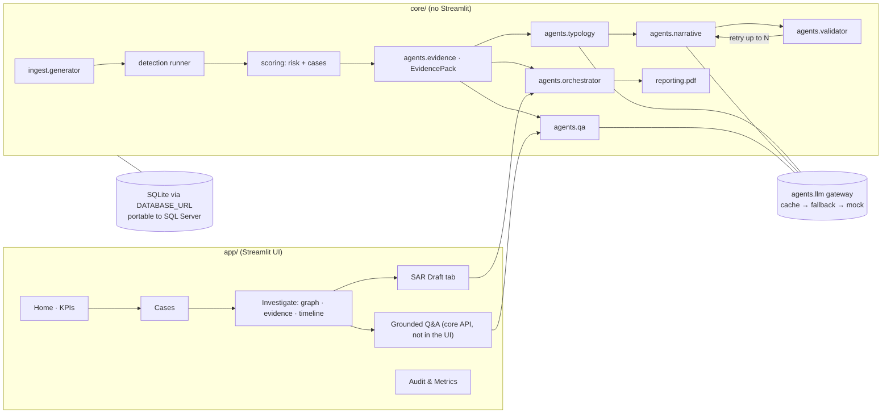

# RingSight — AI Fraud-Ring Investigation & Evidence-Grounded SAR Copilot

> Hackathon kickoff pack. Drop this whole folder into the root of your GitHub repo **before** you start Claude Code.

## What's in this pack

| File | Purpose | Who reads it |
|---|---|---|
| `00_PREREQUISITES_CHECKLIST.md` | Everything to install/create **the day before** | Whole team |
| `CLAUDE.md` | Permanent project memory for Claude Code (rules, stack, conventions) | Claude Code (auto-loaded) |
| `docs/BRD.md` | Business Requirements — the *why* (use for judges & M.Tech intro) | Team, judges |
| `docs/PRD.md` | Product Requirements — features, acceptance criteria | Team, Claude Code |
| `docs/ARCHITECTURE.md` | Stack, folder structure, DB schema, agent flow, JSON contracts | Claude Code |
| `docs/WIREFRAMES.md` | Screen-by-screen layouts + design tokens | Claude Code, UI owner |
| `docs/wireframes/ringsight_mockup.html` | Clickable HTML mockup of all 5 screens (wireframe/hi-fi toggle) | Everyone |
| `config/rules.yaml` | Starter thresholds & weights (single source of truth for detectors) | Claude Code |
| `docs/REVIEW_NOTES.md` | Pre-build review: issues found and what was changed | Team lead |
| `prompts/00_MASTER_PROMPT.md` | The first big prompt that scaffolds the project | Paste into Claude Code |
| `prompts/ITERATIONS.md` | 10 smaller follow-up prompts, in order | Paste one by one |
| `docs/TEAM_PLAN.md` | Hour-by-hour split for 3 members | Team |
| `docs/DEMO_SCRIPT.md` | 10-minute, 3-speaker demo script | Team |
| `.env.example`, `requirements.txt` | Config + dependencies | Everyone |

## One-line pitch
**"RingSight finds hidden money-laundering rings in transaction data in seconds, and drafts a regulator-ready Suspicious Activity Report where every single sentence is traceable to evidence — so analysts sign off in minutes instead of days."**

## Order of work
1. Complete `00_PREREQUISITES_CHECKLIST.md` (day before).
2. Read `docs/REVIEW_NOTES.md`, then commit this pack to `main`.
3. Open Claude Code in repo root → paste `prompts/00_MASTER_PROMPT.md`.
4. Run `prompts/ITERATIONS.md` P1 → P10, committing after each.
5. Rehearse `docs/DEMO_SCRIPT.md` twice.

---

## Architecture at a glance

`core/` is pure Python (never imports Streamlit); `app/` is the Streamlit UI and reads
data only through `core`. All thresholds live in `config/rules.yaml`; every LLM call
goes through the single gateway `core/agents/llm.py` (cache → fallback → deterministic
mock), and the Validator is the source of truth for grounding.



Pipeline: generate/upload → detect (deterministic, explainable) → rank cases →
Evidence Builder → Typology → Narrative ⇄ Validator (grounding score) → review,
approve, PDF. The orchestrator persists versioned drafts, a tamper-evident audit log
and a decision log.

## How to run

Load data (synthetic, your own CSV, or the IBM AML / SAML-D benchmarks) → detect fraud rings with explainable rules → rank cases → investigate on an interactive graph → draft a SAR where every sentence cites evidence and is validated against it → review, approve and export a PDF. Everything works offline with `LLM_MODE=mock`.

### 1. Set up a virtual environment and install dependencies
```bash
python -m venv .venv
# Windows:
.venv\Scripts\activate
# macOS / Linux:
source .venv/bin/activate

pip install -r requirements.txt
```
Python 3.11 or 3.12 is recommended (3.14 also works).

Copy `.env.example` to `.env`. For an **offline, deterministic demo** set
`LLM_MODE=mock` (no API keys needed — the SAR agents produce grounded template
output). For **live** drafting set `LLM_MODE=live` and add `GEMINI_API_KEY` /
`GROQ_API_KEY`; the gateway falls back Gemini → Groq → mock and never crashes the app.

### 2. Run the app
```bash
streamlit run app/Home.py
```
The app is one page with a step bar: **Upload → Detect → Investigate → Report**, plus **Metrics**.

- **Upload** — *Use sample dataset* (seed 42: 500 accounts, ~5,000 transfers, planted laundering patterns), upload your own CSV with column mapping (up to 200 MB), or *Load IBM sample* / *Load SAML-D sample* (labelled benchmark data, see below).
- **Detect** — four headline numbers and the ranked case queue; select a row to investigate.
- **Investigate** — interactive network graph (theme-aware, works offline), the rule-based *Why this was flagged* reason first, account risk, supporting transactions, then **Draft SAR** or **Dismiss with reason**.
- **Report** — the drafted SAR with a citation chip on every statement, a coverage line, a completeness checklist, analyst sign-off, and PDF / text export. Unsupported statements are highlighted and block approval until acknowledged.
- **Metrics** — detection quality against the dataset's labels and the tamper-evident audit log.

Light and dark follow `.streamlit/config.toml`.

### Real data: IBM AML (HI-Small) from Kaggle

*Load IBM AML sample* downloads IBM's public AML benchmark (475 MB, resumable) and samples about 30,000 transactions by laundering label. Put `KAGGLE_API_TOKEN` in `.env` (or place `HI-Small_Trans.csv` in `data/`). Use it to show the pipeline on real labelled data at scale; quality is reported per transaction on Metrics and is modest by design (see `docs/TESTING.md` sections 6–7).

### SAML-D (UK pounds, labelled by laundering type)

*Load SAML-D sample* downloads the SAML-D dataset (about 200 MB zipped, 1 GB of CSV; Oztas et al., IEEE ICEBE 2023, CC BY-NC-SA 4.0, please cite) into `data/saml/` and keeps every UK-pound laundering row plus a seeded sample of normal traffic, about 40,000 transactions. The first load scans the file (about 30 s); the sample is then saved, so later loads are instant. Sampling sizes are in `config/rules.yaml` (`ingest.saml`). The loaders keep one currency, and every amount in the app is shown in the loaded dataset's own currency (GBP here, USD for the other sources). Metrics shows precision and recall plus **recall per laundering type**. With the shipped rules this is a hard dataset (see `docs/SAML_D_EXPERIMENT.md`).

### Before a live demo

```bash
python -c "from core.demo import run_demo; print(run_demo().fingerprint)"
```
Regenerates seed 42, runs detection and pre-warms the top-2 SAR drafts so they replay from cache. Groq's free tier allows about 8,000 tokens/minute on the 120b model, so two back-to-back drafts can fall back to the 20b model; see `docs/TESTING.md` section 7.

### Offline & Windows

Set `LLM_MODE=mock` for a fully offline, deterministic run — no API keys, no network,
the whole golden path (including the pyvis graph, with vis.js inlined) works with the
internet off. The SQLite file and its `data/` folder are created automatically on first
load regardless of the working directory, so a fresh clone runs on Windows out of the box.

### SAR drafting (CLI)
```bash
python -c "from core.agents.orchestrator import run_sar_pipeline; r=run_sar_pipeline('C-001'); print(r.draft_id, r.validation.grounding_score)"
```

### 3. Command-line equivalents
```bash
python -m core.db --reset           # drop + recreate all tables
python -m core.ingest.generator     # generate seed-42 data → DB + data/samples/demo_seed42.csv
python -m core.detection.runner     # run all detectors, score, build cases
python -m core.db --verify-audit    # verify the audit-log hash chain
```

### 4. Tests & lint
```bash
pytest -q          # detectors (recall 1.0, determinism, <10 s), validator grounding, LLM
                   # gateway, PDF, Demo-mode determinism + cache preservation, Ask-the-case Q&A
ruff check .       # clean
```

### Project layout
- **backend** — `core/` (config, db, models, schemas, ingest, detection, scoring, metrics,
  `agents/` LLM pipeline, `reporting/` PDF, `demo.py` demo reset + pre-warm)
- **frontend** — `app/` (Home + pages + components; imports data only via `core`)
- **database** — `core/db.py` + `core/models.py`, SQLite file in `data/` (portable to SQL Server/Postgres via `DATABASE_URL`)
- **rules** — all thresholds/weights live in `config/rules.yaml` (single source of truth)
- **prompts** — SAR agent prompts in `config/prompts/` (typology, narrative)
