# Architecture — RingSight MVP

## 1. Tech stack (all free / open source)

| Layer | Choice | Why |
|---|---|---|
| Language | Python 3.11+ | One language end-to-end; best AI/graph ecosystem |
| UI | **Streamlit** multipage | Fastest to build; AI assistants generate it reliably |
| Graph analytics | **NetworkX** | Cycles, centrality, components — no infra |
| Graph viz | **pyvis** (embedded HTML) | Interactive, draggable network |
| Charts | Plotly | Timeline, KPI charts |
| Data | pandas, Faker | Generation & wrangling |
| Validation / contracts | **Pydantic v2** | Structured LLM output, typed evidence |
| LLM gateway | **LiteLLM** | One API for Gemini, Groq, Ollama; easy fallback |
| Agents | Plain Python orchestrator (state machine) | Deterministic, debuggable in 1 day. *LangGraph = M.Tech upgrade* |
| DB access | **SQLAlchemy 2.0** | SQLite today, SQL Server/Postgres by env change |
| DB | SQLite (default) | Zero setup |
| PDF | ReportLab | Programmatic SAR PDF |
| Config | YAML (`config/rules.yaml`) + `.env` | Thresholds & weights without code changes |
| Tests / lint | pytest, ruff | Keep AI-generated code honest |

**Why not FastAPI + React?** Doubles the build for no judging benefit in one day. The `core/` package is UI-independent, so a FastAPI layer can be added later (stretch P10).

## 2. High-level flow

```mermaid
flowchart LR
  A[CSV upload / Synthetic generator] --> B[(DB: accounts, transactions, identifiers)]
  B --> C[Graph builder - NetworkX]
  C --> D[Detectors: cycle, fan-in, fan-out, shared-ID, pass-through]
  D --> E[Alerts]
  E --> F[Risk scorer + Case builder]
  F --> G[Investigation UI: graph, evidence, why-flagged]
  G --> H[Evidence Builder]
  H --> I[Typology Agent - LLM]
  I --> J[Narrative Agent - LLM]
  J --> K{Validator Agent}
  K -- fail, retry<=2 --> J
  K -- pass --> L[Analyst review: edit / approve / reject]
  L --> M[PDF export + Audit log]
```



## 3. Folder structure

```
ringsight/
├── CLAUDE.md
├── README.md
├── requirements.txt
├── .env.example
├── config/
│   ├── rules.yaml            # thresholds, weights, baseline minutes
│   └── prompts/              # typology.md, narrative.md, judge.md
├── data/                     # sqlite db, generated csvs (git-ignored except samples/)
│   └── samples/demo_seed42.csv
├── core/
│   ├── config.py             # loads .env + rules.yaml
│   ├── db.py                 # engine, session, init_db()
│   ├── models.py             # SQLAlchemy ORM
│   ├── schemas.py            # Pydantic contracts
│   ├── ingest/
│   │   ├── generator.py      # synthetic data + ground truth
│   │   ├── csv_loader.py     # upload + column mapping + validation
│   │   └── ibm_loader.py     # (could) IBM AML subset
│   ├── detection/
│   │   ├── graph_builder.py
│   │   ├── cycles.py
│   │   ├── fan_patterns.py   # fan-in smurfing, fan-out
│   │   ├── shared_ids.py
│   │   ├── passthrough.py
│   │   └── runner.py         # runs all, persists alerts
│   ├── scoring/
│   │   ├── risk.py
│   │   └── cases.py
│   ├── agents/
│   │   ├── llm.py            # LiteLLM wrapper: fallback chain, cache, retries, mock
│   │   ├── evidence.py
│   │   ├── typology.py
│   │   ├── narrative.py
│   │   ├── validator.py
│   │   └── orchestrator.py
│   ├── reporting/
│   │   └── pdf.py
│   └── metrics.py            # precision/recall vs ground truth, time saved
├── app/
│   ├── Home.py               # dashboard
│   ├── pages/
│   │   ├── 1_Data.py
│   │   ├── 2_Cases.py
│   │   ├── 3_Investigate.py
│   │   └── 4_Audit_and_Metrics.py
│   └── components/           # graph.py, badges.py, styles.py
└── tests/
    ├── test_detectors.py
    ├── test_validator.py
    └── test_generator.py
```

## 4. Database schema (SQLAlchemy, portable)

| Table | Key columns |
|---|---|
| `accounts` | account_id (PK), name, bank, country, account_type (`individual`/`business`/`merchant`/`payroll`), created_at |
| `transactions` | txn_id (PK), sender_id (FK), receiver_id (FK), amount, currency, ts, channel, ip, device_id, is_laundering (ground truth, nullable), gt_pattern (nullable, e.g. `cycle`), gt_ring_id (nullable, e.g. `R-03`), dataset_id |
| `identifiers` | id, account_id, id_type (ip/device/phone), value |
| `detection_runs` | run_id, started_at, params_json, n_txns, duration_ms |
| `alerts` | alert_id (`AL-0001`), run_id, pattern, accounts_json, txn_ids_json, total_amount, reason, severity |
| `cases` | case_id, run_id, title, score, status, assigned_to, created_at |
| `case_accounts` | case_id, account_id, risk_score, explanation_json |
| `evidence` | evidence_id (E1..), case_id, kind (txn/identifier/metric/pattern), payload_json |
| `sar_drafts` | draft_id, case_id, version, typology_json, narrative_json, grounding_score, model_used, status |
| `audit_log` | id, ts, actor, action, case_id, before_json, after_json, prev_hash, row_hash (sha256 hash chain → tamper-evident, satisfies BR4) |
| `llm_cache` | prompt_hash (PK), purpose, prompt_version, model, response_text, created_at |
| `decision_log` | id, case_id, draft_id, step, signals_json, outcome (`drafted`/`needs_more_evidence`/`escalated`), created_at — research hook for M.Tech confidence work |

Use generic types only (String, Integer, Float, DateTime, Text, JSON-as-Text) so SQL Server works unchanged.

## 5. Key JSON contracts (Pydantic)

```python
class EvidenceItem(BaseModel):
    id: str                 # "E7"
    kind: Literal["txn", "identifier", "metric", "pattern"]
    summary: str            # "T000412: ACC_0018 -> ACC_0033, 48,200.00 USD, 2026-09-03 10:14"
    data: dict

class EvidencePack(BaseModel):
    case_id: str
    subjects: list[dict]    # account_id, name, bank, risk_score
    patterns: list[str]
    totals: dict            # total_amount, n_txns, date_range
    items: list[EvidenceItem]   # cap ~40 items to stay under free-tier TPM

class TypologyResult(BaseModel):
    typology: str           # e.g. "Layering via circular transfers"
    confidence: float
    rationale: str
    evidence_ids: list[str]

class NarrativeSentence(BaseModel):
    text: str
    evidence_ids: list[str] # MUST be non-empty for every sentence (no "context" exemption in MVP)

class SARNarrative(BaseModel):
    summary: list[NarrativeSentence]
    subjects: list[NarrativeSentence]
    activity: list[NarrativeSentence]
    red_flags: list[NarrativeSentence]
    conclusion: list[NarrativeSentence]

class ValidationIssue(BaseModel):
    section: str; index: int; problem: str

class ValidationResult(BaseModel):
    grounding_score: float  # 0-100
    issues: list[ValidationIssue]
    passed: bool

class ConfidenceSignals(BaseModel):          # logged per draft; not used to gate in MVP
    evidence_coverage: float                 # share of pack items cited at least once
    validator_pass_rate_first_try: float
    retries_used: int
    llm_self_confidence: float | None        # typology confidence, treated as one weak signal
    fallback_used: bool
    data_quality_flags: list[str]            # e.g. "missing_device_id"
```

## 6. Validator logic (the differentiator — keep it deterministic first)
For every sentence:
1. `evidence_ids` non-empty and all exist in the pack.
2. Every **amount** mentioned (regex) matches an amount/total in the cited evidence (±1%).
3. Every **account ID** mentioned exists in cited evidence or subjects.
4. Every **date** mentioned falls inside cited evidence dates.
5. **Speculation lexicon**: reject sentences asserting identity/intent not present in evidence (configurable list in rules.yaml: "shell company", "terrorist", "criminal", "knowingly", "intended to", "drug", "sanctioned"...). Rules 2–4 cannot catch purely qualitative claims, so this rule is what catches the "known shell company" example in the wireframes.
6. **Totals**: sums in a sentence must match a `metric` evidence item (the Evidence Builder emits per-pattern and per-case totals as metric items so sums are citeable).
7. (Optional) LLM judge: "Is this sentence entailed by these evidence items? yes/no + reason".

Be precise in claims: the Grounding Score proves every *number, date, account and cited ID* is consistent with evidence; it is not full semantic entailment unless the LLM judge is on.
Grounding Score = passed sentences / total × 100. Failures → feedback list → Narrative Agent retry (max 2).

## 7. LLM wrapper behaviour (`core/agents/llm.py`)
- Chain: `PRIMARY_MODEL` (Gemini Flash) → `FALLBACK_MODEL` (Groq) → `mock`.
- JSON mode / schema prompt + Pydantic parse; on parse error, one repair attempt.
- Exponential backoff with jitter on HTTP 429.
- Cache key = sha256(purpose + prompt_version + schema name + system + user). Model is stored but **not** part of the key, so a response produced by the fallback model is still a cache hit in the demo. Temperature 0.
- `LLM_MODE=mock` forces template output for offline demo.
- Logs: model, latency ms, tokens (if available), cache hit → shown in Agent Trace panel.

## 7a. Detection design notes (read before implementing detectors)
- **Cycle explosion:** on a random 500-account / 5,000-edge graph, `nx.simple_cycles(G, length_bound=6)` yields ~181k candidate cycles and takes ~9.5 s *before* time-window filtering (measured). Therefore: (1) build the cycle graph from a **filtered** edge set — drop `merchant`/`payroll` endpoints and amounts below `cycles.min_amount`; (2) collapse the MultiDiGraph to a DiGraph for enumeration, then re-check hop times/retention on the real txns; (3) stop after `cycles.max_candidates` and log a warning.
- **Legitimate fan patterns:** payroll accounts fan-out and merchants fan-in by design. Generator must label them via `account_type`; detectors skip types in `exclude_account_types`. Keep a few *unlabelled* edge cases so precision is < 1.0 and the metrics page looks honest.
- **Case grouping:** connected components are computed on the **alert graph** (nodes = accounts in any alert; edge between two accounts if they co-occur in an alert), never on the full transaction graph — the full graph is one giant component.
- **Ground-truth matching:** a planted ring counts as recalled if ≥ `metrics.ring_match_threshold` (default 0.6) of its accounts appear in one case. Report both ring-level and transaction-level P/R/F1.
- **Overlap:** a pass-through can sit inside a cycle; allow one account to carry multiple alerts, but count it once per case.

## 8. Scalability story (for judges)
- Swap SQLite → SQL Server/Postgres via `DATABASE_URL`.
- Batch → streaming: detectors are pure functions over a graph window; plug into Kafka consumer later.
- NetworkX → Neo4j / GNN (M.Tech) behind the same `Alert` interface.
- New typologies = new detector file + rules.yaml entry.
